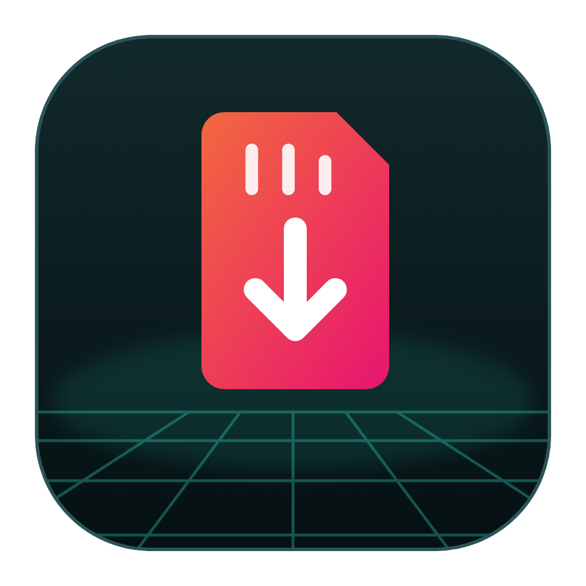
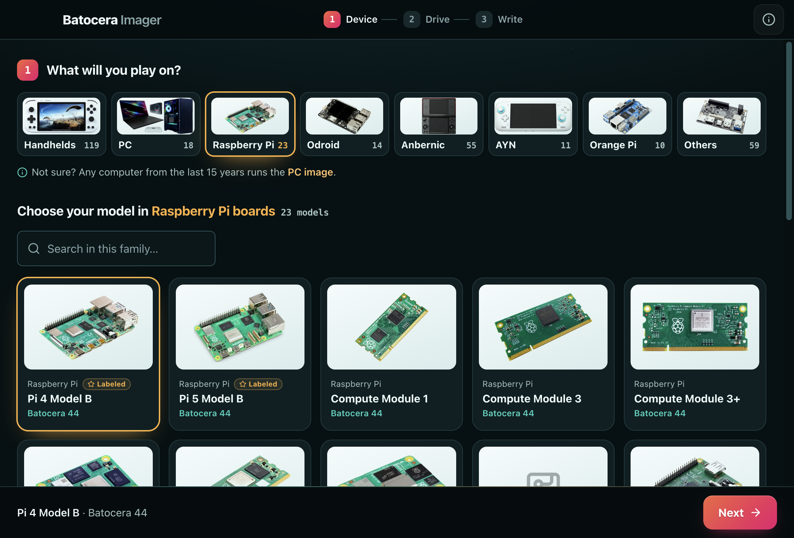
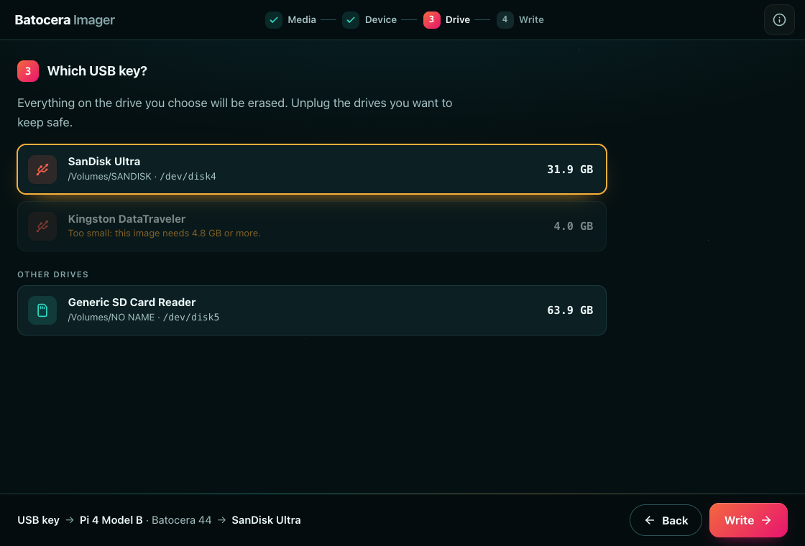
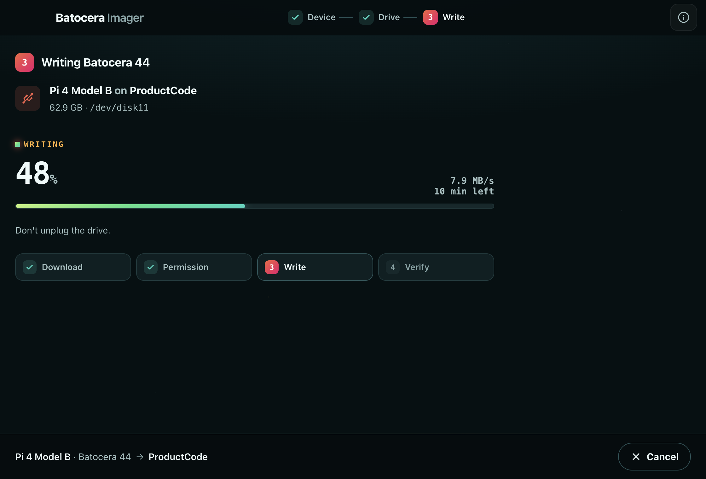

<p align="center">
  
</p>

<h1 align="center">Batocera Imager</h1>

<p align="center">
  <strong>Unofficial installer for Batocera: pick your device and it writes the right image to a USB key or SD card.</strong>
</p>

<p align="center">
  <a href="https://github.com/monteirohat/batocera-imager/actions/workflows/ci.yml"></a>
  <a href="LICENSE"></a>
</p>

---

[Batocera](https://batocera.org) turns a computer, a board or a handheld into a retro console. To
install it, you pick the image made for your device on
[batocera.org/download](https://batocera.org/download), download it, and write it to a USB key or
an SD card with a separate tool. Batocera Imager does it in one place: choose the kind of drive,
your device and the USB key or SD card, and it downloads the right image, checks it, writes it and
reads it back.

> **This project is not made by the Batocera team.** It uses batocera.org's look, its list of
> devices and their photos (loaded from batocera.org), and the images come from Batocera's own
> servers. Batocera's logo is not used until the team agrees.

<p align="center">
  
</p>

## How to use

1. **Media.** Choose what Batocera goes on: a USB key, an SD card or an external drive.
2. **Device.** Choose the family (handhelds, PC, Raspberry Pi…) and your model, as on the
   download page. The model decides which image is written.
3. **Drive.** Plug in the drive and choose it. Only external and removable drives are listed;
   drives too small for the image are greyed out.
4. **Write.** Confirm. The installer asks for your password on macOS and Linux, then downloads,
   writes and verifies. At the end the drive is ejected.

<p align="center">
  
  
</p>

## What it does

- **Reads batocera.org/download** for the families, the models and their images, and keeps the
  list for when the site can't be reached.
- **Downloads the image**, resuming if the connection drops, and **checks its MD5** before any
  drive is touched. The image is kept for next time (About deletes it).
- **Writes and reads back**: a SHA-256 of what was written is compared with what the drive gives
  back, which catches a damaged or fake drive.
- **Never offers the computer's own disks**, and checks again right before erasing that the drive
  is still the one you chose.

How it works on each system, and the safety rules: [docs/ARCHITECTURE.md](docs/ARCHITECTURE.md).

## Status

Early. The whole job has been tested on macOS with a test disk, and the drive filters on real
Linux output. A USB key on each system (and the password prompts) is the next test before a
first release. There is no release yet: build it from source.

## Building from source

Requirements: [Node.js 20+](https://nodejs.org).

```bash
git clone https://github.com/monteirohat/batocera-imager.git
cd batocera-imager
npm install
npm run dev          # development, with live reload of the interface
npm test             # tests
npm run dist         # installers for the current system, in release/
```

On Linux, writing needs polkit's `pkexec` (installed on most desktops). On Windows the installer
runs as administrator.

## Contributing

The look follows [docs/STYLE.md](docs/STYLE.md), taken from batocera.org: read it before changing
a screen.

## License

[MIT](LICENSE). Batocera is a trademark of its authors; this project is not affiliated with them.
